  

  

  
  
  

---

### 🧙‍♂️ About me

- 🎯 **Forward deployed AI engineer**: I embed with a team, find the workflow that hurts, and ship an agent that fixes it in production
- 🤖 **AI developer** focused on agentic systems such as multi-agent orchestration, subagents, and long-running background agents
- ⚙️ **AI automation**: I turn manual ops into durable, observable pipelines with human-in-the-loop checkpoints
- 🔌 I build **MCP servers**, **agent skills**, and tool layers that connect models to real APIs, databases, and SaaS tools
- 🔎 **RAG and agentic search** with hybrid retrieval, reranking, and Postgres-native vectors
- 🧪 **Evals come first**: tracing, LLM-as-judge, and golden datasets gate every prompt and model change
- 🛠 I live in **Claude Code** and build custom subagents, hooks, and plugins
- 💬 Ask me about agent design, context engineering, MCP, or taking AI from demo to production

---

### ⚡ AI engineering stack

<table>
  <tr>
    <td><b>Frontier & open models</b></td>
    <td>
      
      
      
      
      
      
      
    </td>
  </tr>
  <tr>
    <td><b>Agent frameworks</b></td>
    <td>
      
      
      
      
      
      
      
      
    </td>
  </tr>
  <tr>
    <td><b>Protocols & interop</b></td>
    <td>
      
      
      
      
    </td>
  </tr>
  <tr>
    <td><b>Prompt programming</b></td>
    <td>
      
      
      
      
    </td>
  </tr>
  <tr>
    <td><b>Durable workflows & automation</b></td>
    <td>
      
      
      
      
      
      
      
    </td>
  </tr>
  <tr>
    <td><b>Agent runtime & computer use</b></td>
    <td>
      
      
      
      
      
      
    </td>
  </tr>
  <tr>
    <td><b>Web data & retrieval</b></td>
    <td>
      
      
      
      
      
      
      
      
    </td>
  </tr>
  <tr>
    <td><b>Voice & realtime agents</b></td>
    <td>
      
      
      
      
    </td>
  </tr>
  <tr>
    <td><b>Inference, gateways & fine-tuning</b></td>
    <td>
      
      
      
      
      
      
      
    </td>
  </tr>
  <tr>
    <td><b>Evals & observability</b></td>
    <td>
      
      
      
      
      
      
    </td>
  </tr>
  <tr>
    <td><b>AI dev tools</b></td>
    <td>
      
      
      
      
    </td>
  </tr>
</table>

---

### ✨ What I build

| Area | What that looks like |
|---|---|
| 🧠 **Multi-agent systems** | Orchestrator/worker and planner/critic loops, plus agent-to-agent (A2A) handoff |
| ⚙️ **AI pipelines** | Durable, retryable ingestion → enrichment → action flows with human-in-the-loop approvals |
| 🔌 **MCP servers & agent skills** | Exposing internal APIs, DBs, and SaaS tools safely to any model |
| 🖥️ **Computer & browser agents** | Agents that drive real UIs in sandboxed browsers and VMs |
| 📚 **RAG & agentic search** | Hybrid BM25 + dense retrieval, reranking, query planning, and grounded citations |
| 🧩 **Context engineering** | Prompt caching, compaction, long-term memory, and structured outputs |
| 🎙️ **Voice agents** | Realtime speech-to-speech assistants with tool calling |
| 🛡️ **Evals & guardrails** | Tracing, LLM-as-judge, golden sets, and cost and latency budgets in CI |

---

### 🚀 Featured projects

<table>
  <tr>
    <td width="50%" valign="top">
      <h4><a href="https://github.com/muhammad-rafey/hadith-search">🔎 hadith-search</a></h4>
      Semantic search over Sahih al-Bukhari (English + Arabic) using hybrid BM25 + vector retrieval and cross-encoder reranking. One backend serves both web and mobile.  
      
      
      
    </td>
    <td width="50%" valign="top">
      <h4><a href="https://github.com/muhammad-rafey/terms-analyzer">⚖️ terms-analyzer</a></h4>
      AI-powered Terms & Conditions analyzer that flags risky clauses using an LLM.  
      
      
    </td>
  </tr>
  <tr>
    <td width="50%" valign="top">
      <h4><a href="https://github.com/muhammad-rafey/quran-grammar">📖 quran-grammar</a></h4>
      Urdu Quran grammar study app for web, Android and iOS, backed by one API.  
      
    </td>
    <td width="50%" valign="top">
      <h4><a href="https://github.com/muhammad-rafey/upwork-wayland-workaround">🖥️ upwork-wayland-workaround</a></h4>
      Lets Upwork time tracking run on pure GNOME Wayland by emulating the X11 screenshot API.  
      
    </td>
  </tr>
</table>

---

### 📈 Activity

  <picture>
    <source media="(prefers-color-scheme: dark)" srcset="https://raw.githubusercontent.com/muhammad-rafey/muhammad-rafey/output/activity-graph-dark.svg" />
    
  </picture>

  <picture>
    <source media="(prefers-color-scheme: dark)" srcset="https://raw.githubusercontent.com/muhammad-rafey/muhammad-rafey/output/github-snake-dark.svg" />
    
  </picture>

Graphs are self-generated every 6 hours by a <a href=".github/workflows/profile-visuals.yml">GitHub Action</a>, with no third-party stats service.

---

### 💭 Quote of the day

  <picture>
    <source media="(prefers-color-scheme: dark)" srcset="https://quotes-github-readme.vercel.app/api?type=horizontal&theme=dark" />
    
  </picture>

  

